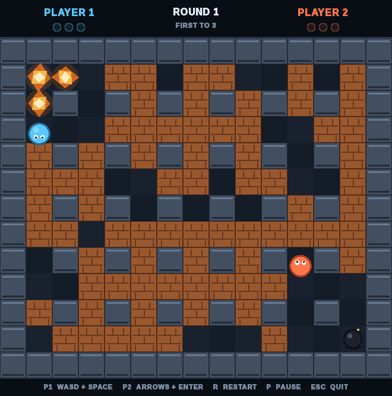

# BomberBoy

A two-player, same-keyboard Bomberman-style arena battle written in C++17 with
[SFML](https://www.sfml-dev.org/) 2.6. Everything is drawn with SFML primitives at
runtime, so there are no art assets to install - just the executable and a system
font for the HUD.



## Features

- Local 2-player duel on a 15 x 13 grid arena that is regenerated every round.
- Bombs with a 2.4 s fuse, cross-shaped blasts and full chain reactions.
- Classic "walk off your own bomb, then it turns solid" bomb handling.
- Three power-ups hidden in the destructible bricks.
- Best-of rounds (first to 3 by default) with a round-over / match-over overlay.
- Hand-drawn look: brick textures, animated bomb sparks, flame glow, ghost players
  with eyes that follow the walking direction.
- Headless logic test suite (`--selftest`) and an offscreen screenshot mode.

## Requirements

- A C++17 compiler (GCC, Clang or MSVC)
- CMake 3.16+ *or* GNU Make
- SFML 2.5/2.6 (`graphics`, `window` and `system` modules)
- A system font for the HUD text (see [Fonts](#fonts))

Install SFML on common distributions:

```bash
sudo apt install libsfml-dev          # Debian / Ubuntu
sudo dnf install SFML-devel           # Fedora
sudo pacman -S sfml                   # Arch
brew install sfml                     # macOS
```

## Build

With CMake:

```bash
cmake -S . -B build -DCMAKE_BUILD_TYPE=Release
cmake --build build -j
./build/bomberboy
```

With the convenience Makefile:

```bash
make          # builds ./bomberboy
make run
```

## Controls

| Action            | Player 1              | Player 2                       |
| ----------------- | --------------------- | ------------------------------ |
| Move              | `W` `A` `S` `D`       | Arrow keys                     |
| Drop a bomb       | `Space`               | `Enter` or right `Ctrl`        |

Global keys: `R` restarts the round (or starts a rematch once the match is over),
`P` pauses, `Esc` quits. Player 2 drops a bomb on either `Enter` or right `Ctrl`,
so keyboards without a usable numpad key still work.

## Rules

- Each round both players spawn in opposite corners with one bomb, a one-tile
  blast and normal speed. The arena is 15 x 13 tiles with indestructible pillars
  and destructible bricks; the 5 x 5 pocket around each spawn is kept clear.
- A bomb explodes after 2.4 s. The blast runs one tile per blast range in the four
  directions, stops at walls, destroys the first brick it touches and fades after
  0.45 s. A blast that touches another bomb detonates it immediately - chains can
  clear half the arena at once.
- You can always step off the bomb you just dropped, but as soon as your body has
  fully left that tile the bomb becomes solid and blocks you (and everyone else).
- Standing in a flame eliminates you. The last player alive wins the round and
  scores a point; if both die in the same frame the round is a double knockout and
  is replayed without a score.
- The first player to win 3 rounds wins the match. Press `R` for a rematch.


### Power-ups

Destroyed bricks have a 28% chance to reveal a pickup. Walk over it to collect it:

| Pickup      | Look        | Effect                                        |
| ----------- | ----------- | --------------------------------------------- |
| Extra Bomb  | bomb icon   | +1 simultaneous bomb (1 to 8)                 |
| Extra Blast | plus icon   | +1 blast range (1 to 9)                       |
| Speed       | bolt icon   | +0.5 tiles/s movement (3.6 up to 6.6)         |

A destroyed brick can also stay empty, so not every explosion pays out.


## Command line

```
Usage: bomberboy [options]
  --selftest           run the headless logic checks and exit
  --seed <n>           build the arena from a fixed seed
  --screenshot <file>  render one frame to a PNG instead of opening a window
  --autoplay <s>       scripted play seconds before the screenshot
  -h, --help           show the help text
```

Examples:

```bash
./build/bomberboy --selftest
./build/bomberboy --seed 7
./build/bomberboy --seed 7 --autoplay 2.6 --screenshot shot.png
```

`--screenshot` renders into an offscreen `sf::RenderTexture`, so it needs an
OpenGL-capable display but never opens a window. It is handy for checking the
look of a build or for grabbing documentation images.

## Testing

The whole game logic lives in `bb::Game`, which does not depend on SFML at all.
That keeps the rules testable from a plain console program:

```bash
./build/bomberboy --selftest     # 59 checks, exit code 0 on success
ctest --test-dir build --output-on-failure
```

The suite covers fresh-match state, arena generation (borders, pillars, spawn
pockets), border collision, bomb placement and fuse timing, the ownership rules
for dropped bombs, chain reactions, round resets, the match flow and a seeded
random-play stress test that keeps checking for players stuck inside walls or
bricks.

## Project layout

```
CMakeLists.txt          CMake build (also registers the CTest self-test)
Makefile                plain g++ build: make, make run, make test
src/game.hpp  game.cpp  arena, players, bombs, flames, power-ups, scoring (SFML-free)
src/renderer.*          all drawing: tiles, bombs, flames, players, HUD, overlays
src/selftest.*          the headless checks behind --selftest
src/main.cpp            window, input mapping, command line handling, demo replay
docs/*.png              screenshots used by this README
```

## Design notes

- **Logic / rendering split.** `Game` owns every rule and only exposes read-only
  getters, so the renderer can never desync the simulation. The same class powers
  the interactive game, the self-test and the screenshot mode.
- **Movement.** Strictly four-directional. Inputs are advanced in six sub-steps
  per frame and the player is gently snapped towards the centre of the corridor,
  which prevents tunnelling through walls and getting caught on corners.
- **Determinism.** All randomness comes from one `std::mt19937` seeded through the
  `Game` constructor, so `--seed` plus a fixed input script reproduces a round
  exactly. That is how the screenshot mode produces its action frame.
- **Fonts.** The renderer probes a list of common system fonts (DejaVu, Liberation,
  Carlito, FreeSans, Open Sans, Cantarell, Adwaita, Arial). Set
  `BOMBERBOY_FONT=/path/to/font.ttf` to force a specific font, or drop one at
  `assets/font.ttf`. Without any font the game still runs, it just skips the text.

## License

Personal project, no license file yet - ask before reusing it.
