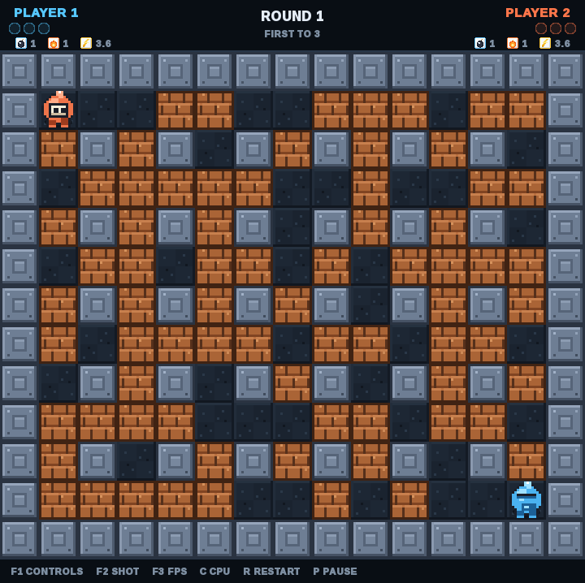

# BomberBoy

A two-player, same-keyboard Bomberman-style arena battle written in C++17 with
[SFML](https://www.sfml-dev.org/) 2.6. The arena is drawn with a small pixel-art
sprite set that ships in `assets/sprites`, and every sprite can be replaced with
your own PNGs; a shape-drawn fallback keeps the game playable without any art on
disk.


## Features

- Local 2-player duel on a 15 x 13 grid arena that is regenerated every round.
- Bombs with a 2.4 s fuse, cross-shaped blasts and full chain reactions.
- Spawns start boxed in by crates, so the opening bomb always blows one open.
- Classic "walk off your own bomb, then it turns solid" bomb handling.
- A pulsing ring marks every live bomb, even while its owner stands on it.
- Three power-ups hidden in the destructible bricks.
- Best-of rounds (first to 3 by default) with a round-over / match-over overlay.
- 16 x 16 pixel-art sprites for tiles, bombers, bombs, flames and pickups, drawn
  at 3x zoom with nearest-neighbour scaling.
- Headless logic test suite (`--selftest`) and an offscreen screenshot mode.
- A computer opponent for player two (`--cpu`, or press `C` mid-round): it clears
  crates, grabs the power-ups it can reach, never walks into a fuse it cannot
  outrun and never blows itself up.
- HUD with each player's current loadout (bombs, blast range, speed), the round
  pips, a `COMPUTER` tag when the AI plays and a smoothed FPS / frame-time readout
  in the footer.
- Resizable window: the fixed 720 x 718 canvas is letterboxed and snapped to a
  whole-number zoom, so the pixel art stays crisp at every size, up to fullscreen.
- In-game controls panel (`F1`) and a one-key screenshot of the live window
  (`F2`, written to `bomberboy-shot-N.png`).

## Requirements

- A C++17 compiler (GCC, Clang or MSVC)
- CMake 3.16+ *or* GNU Make
- SFML 2.5/2.6 (`graphics`, `window` and `system` modules)
- A system font for the HUD text (see [Fonts](#fonts))

Install SFML on common distributions:

```bash
sudo apt install libsfml-dev          # Debian / Ubuntu
sudo dnf install SFML-devel           # Fedora
sudo pacman -S sfml                   # Arch
brew install sfml                     # macOS
```

## Build

With CMake:

```bash
cmake -S . -B build -DCMAKE_BUILD_TYPE=Release
cmake --build build -j
./build/bomberboy
```

With the convenience Makefile:

```bash
make          # builds ./bomberboy
make run
```

## Controls

| Action            | Player 1              | Player 2                       |
| ----------------- | --------------------- | ------------------------------ |
| Move              | `W` `A` `S` `D`       | Arrow keys                     |
| Drop a bomb       | `Space`               | `Enter` or right `Ctrl`        |

Global keys: `F1` opens the controls panel (the round is frozen while it is open),
`F2` saves a screenshot, `F3` shows or hides the FPS counter, `F11` toggles
fullscreen, `C` hands player two to the computer and back, `R` restarts the round
(or starts a rematch once the match is over), `P` pauses, and `Esc` closes the
controls panel - pressing it again, with no panel open, quits. Player 2 drops a
bomb on either `Enter` or right `Ctrl`, so keyboards without a usable numpad key
still work. The round also pauses itself when the window loses focus.

## Rules

- Each round both players spawn in opposite corners with one bomb, a one-tile
  blast and normal speed. The arena is 15 x 13 tiles with indestructible pillars
  and destructible bricks.
- A spawn keeps a three-tile pocket clear - the spawn tile plus a two-tile lane
  that leads toward the middle of the arena - and at least one crate always sits
  next to the spawn. Drop your opening bomb, step into the lane and the crate is
  gone; the second lane tile is outside the one-tile blast.
- A bomb explodes after 2.4 s. The blast runs one tile per blast range in the four
  directions, stops at walls, destroys the first brick it touches and fades after
  0.45 s. A blast that touches another bomb detonates it immediately - chains can
  clear half the arena at once.
- You can always step off the bomb you just dropped, but as soon as your body has
  fully left that tile the bomb becomes solid and blocks you (and everyone else).
- Standing in a flame eliminates you. The last player alive wins the round and
  scores a point; if both die in the same frame the round is a double knockout and
  is replayed without a score.
- The first player to win 3 rounds wins the match. Press `R` for a rematch.



### Power-ups

Destroyed bricks have a 28% chance to reveal a pickup. Walk over it to collect it:

| Pickup      | Look          | Effect                                |
| ----------- | ------------- | ------------------------------------- |
| Extra Bomb  | bomb icon     | +1 simultaneous bomb (1 to 8)         |
| Extra Blast | flame icon    | +1 blast range (1 to 9)               |
| Speed       | bolt icon     | +0.5 tiles/s movement (3.6 up to 6.6) |

A destroyed brick can also stay empty, so not every explosion pays out.

## Art assets

All graphics come from `assets/sprites/*.png`. The set ships with the repo, so a
normal build shows the pixel-art look immediately; the renderer searches
`assets/sprites`, `../assets/sprites` and `../../assets/sprites`, and
`BOMBERBOY_ASSETS=/some/dir` overrides the search. If the PNGs are missing the
game falls back to drawing everything with SFML shapes.

Every sprite is 16 x 16 pixels and is drawn at 48 px (3x) with nearest-neighbour
filtering, so the art stays crisp; the window then scales that whole canvas by a
whole-number factor whenever it can (see `--scale` and `F11` below).

| File pattern                       | Sprite                                              |
| ---------------------------------- | --------------------------------------------------- |
| `floor.png` `wall.png` `brick.png` | arena tiles                                          |
| `player1_<facing>.png`             | blue bomber, `<facing>` = `down` `up` `left` `right` |
| `player2_<facing>.png`             | orange bomber                                        |
| `bomb0..2.png`                     | bomb with a flickering fuse spark                    |
| `flame_center0..1.png`             | explosion core                                       |
| `flame_h0..1.png` `flame_v0..1.png`| horizontal / vertical blast arms                    |
| `powerup_bomb/range/speed.png`     | the three pickups                                    |

To reskin the game, drop 16 x 16 PNGs with the same names into `assets/sprites`.
To edit the built-in art, change `tools/generate_assets.cpp` and regenerate:

```bash
make assets                                    # Makefile: builds and reruns the generator
cmake --build build --target generate_assets   # CMake: builds the tool
./build/generate_assets assets/sprites         # then run it yourself
```

The generator only needs SFML - no art program - which keeps the look of the game
reviewable as code.

## Command line

```
BomberBoy - two player bomb battle

Usage: bomberboy [options]
  --selftest           run the headless logic checks and exit
  --seed <n>           build the arena from a fixed seed
  --cpu                let the computer play player two
  --fps <n>            frame cap, 0 runs uncapped (default 60)
  --scale <n>          start with an n times bigger window (1-4)
  --fullscreen         start in fullscreen
  --screenshot <file>  render one frame to a PNG instead of opening a window
  --autoplay <s>       scripted play seconds before the screenshot
  -h, --help           show the help text

Controls
  Player 1   W A S D to move, Space to drop a bomb
  Player 2   Arrow keys to move, Enter or Right Ctrl to drop a bomb
  C  hand player two to the computer (or take it back)
  R  restart round (or rematch once the match is over)
  P  pause    F1  help    F2  screenshot    F3  FPS counter
  F11 fullscreen    Esc  quit (closes the help panel first)
```

Every flag is checked: an unknown option, a missing value or a number outside the
range in this list stops the game with a one-line message and the usage text
instead of quietly falling back to a default. `--scale` is a request, not a
promise - it is reduced to the largest factor that still fits on the desktop, and
the game says so when that happens. The window then opens in the middle of the
desktop rather than wherever the window manager decides.

Examples:

```bash
./build/bomberboy --selftest
./build/bomberboy --seed 7
./build/bomberboy --cpu --seed 7
./build/bomberboy --fps 0                  # uncapped, the footer shows the result
./build/bomberboy --scale 2
./build/bomberboy --fullscreen
./build/bomberboy --seed 7 --autoplay 2.6 --screenshot shot.png
```

`--screenshot` renders into an offscreen `sf::RenderTexture`, so it needs an
OpenGL-capable display but never opens a window. It is handy for checking the
look of a build or for grabbing documentation images. During play `F2` grabs the
live window instead, letterboxing and all, into `bomberboy-shot-1.png`,
`bomberboy-shot-2.png` and so on.

## Testing

The whole game logic lives in `bb::Game`, which does not depend on SFML at all.
That keeps the rules testable from a plain console program:

```bash
./build/bomberboy --selftest     # 92 checks with the shipped art, exit code 0
ctest --test-dir build --output-on-failure
```

The suite covers fresh-match state, arena generation (borders, pillars, spawn
lanes and the crate next to each spawn), border collision, bomb placement and fuse
timing, the opening bomb destroying a crate while the bomber escapes, the
ownership rules for dropped bombs, chain reactions, round resets, the match flow
and a seeded random-play stress test that keeps checking for players stuck inside
walls or bricks. Five checks pin the `MatchRules` clamping - starting bombs, blast
range, speed and the rounds needed to win all have a valid window, and a rule set
built by code has to land inside it. Three more checks let the computer opponent
play on its own and assert that it drops bombs, clears crates and never kills
itself; a fourth feeds two brains the same match and requires identical inputs,
so the opponent stays deterministic.

Twelve checks cover the command line: the defaults, every option in one arbitrary
order, both spellings of `--help`, the `--test` alias, and the errors for unknown
flags, missing values and out-of-range numbers. The usage text also has to list
every flag, which catches a new option that was only half wired up. The parser
lives in `cli.cpp` rather than in `main()` so all of this runs headless.

Two more checks read the PNG headers in `assets/sprites`: every sprite the
renderer asks for must be there and must be a square image. That catches renamed
or half-copied art right after a reskin. They are skipped (and the run reports
90 checks) when the art is not installed, because the shape fallback is then the
expected look. No OpenGL context is needed - only the first 24 bytes of each file
are read.

Six more checks cover the window scaling: the fixed canvas has to be mapped
exactly at 1x and 2x, stay centred with bars in an odd-sized window, still fit
when the window is smaller than the canvas and never produce a degenerate view
for a zero-sized one. That is pure math on `sf::View`, so it also runs headless.

## Project layout

```
CMakeLists.txt          CMake build (also registers the CTest self-test)
Makefile                plain g++ build: make, make run, make test, make assets
src/game.hpp  game.cpp  arena, players, bombs, flames, power-ups, scoring (SFML-free)
src/ai.hpp  ai.cpp      the computer opponent that drives player two
src/cli.hpp  cli.cpp    strict command line parsing and the --help text
src/renderer.*          sprite and shape drawing: tiles, bombs, flames, players, HUD
src/assets.*            sprite-sheet loading and the assets/sprites search path
src/selftest.*          the headless checks behind --selftest
src/main.cpp            window, input mapping, rendering loop, demo replay
tools/generate_assets.cpp  regenerates the pixel-art PNGs in assets/sprites
assets/sprites/*.png    the 16 x 16 sprite set used by the renderer
docs/*.png              screenshots used by this README
```

## Design notes

- **Logic / rendering split.** `Game` owns every rule and only exposes read-only
  getters, so the renderer can never desync the simulation. The same class powers
  the interactive game, the self-test and the screenshot mode.
- **Input.** Movement polls the keyboard, but bomb drops are edge triggered from
  `sf::Event::KeyPressed`. A quick tap can therefore never be missed between two
  frames, and because key repeat is disabled a held key still drops only one bomb.
  The controls panel owns `Esc` while it is open, so closing it never costs a
  match.
- **Command line.** Every flag is parsed by `bb::parseOptions()` in `cli.cpp` and
  described by one table that also prints the `--help` text, so a flag cannot be
  documented in one place and forgotten in the other. Bad input - an unknown flag,
  a missing value, a number outside the range - is a hard error with a message
  instead of a silent default, and keeping the parser out of `main()` is what lets
  the self-test cover it.
- **Movement.** Strictly four-directional. Inputs are advanced in six sub-steps
  per frame and the player is gently snapped towards the centre of the corridor,
  which prevents tunnelling through walls and getting caught on corners.
- **Computer opponent.** `AiBrain` reads nothing but the public `Game` state and
  its own seeded `std::mt19937`, so a seeded match replays identically. It decides
  one tile at a time and only from the middle of a tile, because the game hurts
  whatever tile the body box touches - a brain that stops on a tile boundary can
  be caught by the blast covering the tile it just left. Every bomb gets a burn
  time that follows chain reactions, and the opponent may only step onto a
  burning tile when it can be off it again before the blast arrives; a drop is
  only made when the whole way out fits that budget with a little slack, and the
  escape it was checked against stays committed instead of being re-planned on
  the next frame, when the fuse has already ticked down. With no crate left in
  reach it walks to a power-up before it goes hunting for the other player, using
  the same safe-tile search it uses for everything else.
- **Sprites.** `SpriteSet` loads the PNGs once at start-up and the renderer only
  falls back to shapes when a sprite is missing, so the game never depends on the
  art being installed.
- **Window and UI.** The renderer always draws the same 720 x 718 canvas and
  `Renderer::viewFor()` maps it onto the window: the canvas is centred, the spare
  space becomes bars, and the zoom snaps to a whole number whenever that keeps at
  least 85% of the window, so resized and fullscreen windows keep the art crisp
  instead of blurring it. The startup window is centred on the desktop and
  `--scale` is reduced to the largest whole factor that still fits there, so a big
  scale can never open a window the desktop cannot show. Re-creating the window for
  `F11` drops the OpenGL context, so `reloadAssets()` re-uploads the font and the
  sprite textures.
- **Frame timing.** The simulation never advances more than 50 ms per frame, so a
  stall cannot push a player through a wall, while the footer readout follows the
  real frame time and is smoothed with an exponential moving average: a stutter
  shows up without turning the number into noise. `--fps 0` lifts the cap.
- **Determinism.** All randomness comes from one `std::mt19937` seeded through the
  `Game` constructor, so `--seed` plus a fixed input script reproduces a round
  exactly. That is how the screenshot mode produces its action frame.
- **Fonts.** The renderer probes a list of common system fonts (DejaVu, Liberation,
  Carlito, FreeSans, Open Sans, Cantarell, Adwaita, Arial). Set
  `BOMBERBOY_FONT=/path/to/font.ttf` to force a specific font, or drop one at
  `assets/font.ttf`. Without any font the game still runs, it just skips the text.

## License

Personal project, no license file yet - ask before reusing it.
